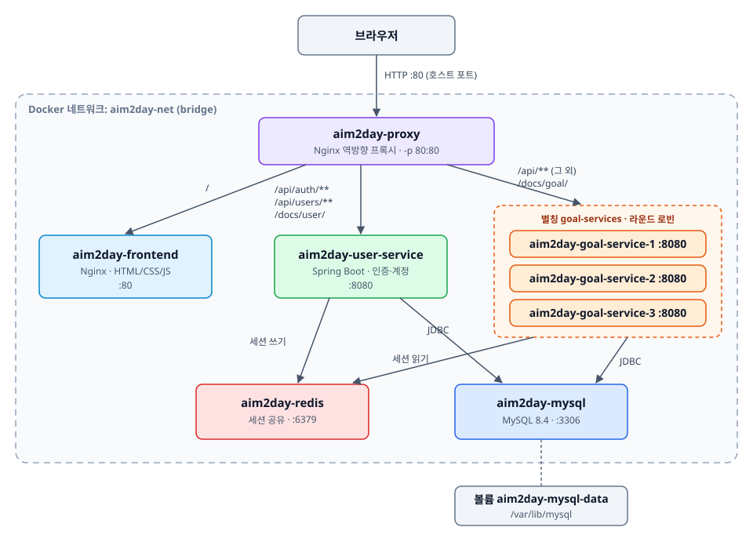

# Aim2Day

연간 목표를 월간·주간 목표와 오늘의 행동으로 쪼개어, 급한 일보다 중요한 목표에 집중하도록 돕는 웹 서비스입니다.

> 중요하지 않지만 급한 일에 빠지지 않고, 중요한 목표에만 정말 집중하는 삶을 살아가도록 돕는다.

## 주요 기능

- **회원**: 이메일 인증번호로 가입(가입 후 자동 로그인), 로그인·로그아웃, 비밀번호 재설정, 계정 설정
- **온보딩**: 연간 → 월간 → 주간 목표와 오늘 행동을 한 번에 작성(입력 중 자동 저장, 나중에 이어 쓰기)
- **목표 계층**: 연간 목표와 달성 기준, 월간·주간 목표, 수치형·체크형 진행률
- **오늘 행동**: 주간 목표에 연결된 행동과 목표와 무관한 생활 업무(Maintenance)를 나눠 관리
- **사분면**: 오늘 한 행동을 중요도·긴급도 좌표에 놓아 시간 사용을 돌아봄
- **달력·대시보드**: 일정·과제와 오늘 할 일을 한 화면에서 확인
- **리포트·회고**: 주·월·분기·연간 리포트와 직접 쓰는 회고
- **휴지통**: 삭제한 목표를 30일 동안 복원

## 시스템 구성

컨테이너 8개가 사용자 정의 브리지 네트워크 `aim2day-net` 하나에 연결됩니다. 호스트에 포트를 여는 것은 역방향 프록시(80)뿐입니다.



| 컨테이너 | 이미지 | 역할 |
|---|---|---|
| `aim2day-proxy` | `aim2day-proxy` (nginx) | 경로별로 요청을 나눔. goal-service 3대에 라운드 로빈 분산 |
| `aim2day-frontend` | `aim2day-frontend` (nginx:alpine) | 순수 HTML·CSS·JavaScript 정적 파일 서빙 |
| `aim2day-user-service` | `aim2day-user-service` (Spring Boot) | 가입·로그인·로그아웃·비밀번호 재설정·내 정보 |
| `aim2day-goal-service-1~3` | `aim2day-goal-service` (Spring Boot) | 목표 계층·행동·사분면·달력·리포트·설정. 같은 이미지로 3대 실행 |
| `aim2day-redis` | `redis:8-alpine` | Spring Session 저장소. 모든 서버 컨테이너가 같은 세션을 읽음 |
| `aim2day-mysql` | `mysql:8.4` | 데이터 저장. 볼륨으로 컨테이너를 다시 만들어도 데이터 유지 |

### 요청 흐름

1. 로그인하면 user-service가 Redis에 세션(`userId`)을 저장하고 브라우저에 `SESSION` 쿠키를 줍니다.
2. 이후 `/api/goals` 같은 요청은 프록시가 goal-service 1·2·3 중 하나로 돌려 보냅니다.
3. 어느 goal-service가 받아도 같은 Redis에서 세션을 찾으므로 로그인이 유지됩니다.
4. goal-service 응답의 `X-Instance-Id` 헤더로 어느 컨테이너가 처리했는지 확인할 수 있습니다.
5. 상태를 바꾸는 요청은 `XSRF-TOKEN` 쿠키 값을 `X-XSRF-TOKEN` 헤더로 보내야 합니다(CSRF 방어).

## 기술 스택

| 구분 | 사용 기술 |
|---|---|
| 프론트엔드 | HTML, CSS, JavaScript(ES 모듈, 빌드 도구 없음), 해시 라우팅 |
| 백엔드 | Java 21, Spring Boot 4, Spring Security, Spring Session(Redis), Spring Data JPA, Flyway, springdoc-openapi |
| 데이터 | MySQL 8.4, Redis 8 |
| 인프라 | Docker(Compose 없이 `docker run`), Nginx |
| 테스트 | JUnit 5, Python 서버 E2E 스크립트, Playwright 화면 E2E |

## 디렉토리 구조

```text
Aim2Day/
├── README.md
├── frontend/                        # 프론트엔드 컨테이너 (nginx:alpine)
│   ├── Dockerfile
│   ├── index.html                   # 단일 페이지, 해시 라우팅(#/dashboard 등)
│   ├── reset-password.html          # 비밀번호 재설정 메일 링크 진입점
│   ├── css/
│   └── js/
│       ├── main.js                  # 시작점
│       ├── router.js                # 해시 라우터
│       ├── api.js                   # fetch 래퍼(CSRF 헤더, 401 처리)
│       ├── auth.js                  # 로그인 상태
│       └── views/                   # 화면별 모듈(dashboard, calendar, goals, plan, reports …)
├── services/
│   ├── user-service/                # 인증·계정 서비스 (Spring Boot)
│   │   ├── Dockerfile
│   │   ├── build.gradle
│   │   └── src/
│   │       ├── main/                # 코드, 설정, Flyway 마이그레이션
│   │       └── test/
│   └── goal-service/                # 목표 서비스 (Spring Boot, 컨테이너 3개)
│       ├── Dockerfile
│       ├── build.gradle
│       └── src/
│           ├── main/
│           └── test/
├── infra/
│   ├── nginx/                       # 역방향 프록시 컨테이너
│   │   ├── Dockerfile
│   │   └── default.conf             # 경로별 라우팅, goal-services 라운드 로빈
│   └── scripts/                     # 이미지 빌드·컨테이너 실행 스크립트
│       ├── build-images.sh
│       └── run-all.sh
├── docs/
│   ├── aim2day/                     # 요구사항·화면 흐름·기능·ERD·API 명세, 공유 계약, 컨테이너 명령어
│   ├── images/                      # README 그림
│   ├── conventions.md               # 파일명·커밋 규칙
│   ├── project-grading-criteria.md  # 과제 기준
│   └── progress.md                  # 진행 현황과 결정 기록
├── design/
│   └── aim2day-prototype.html       # 화면 시안
└── tools/
    └── e2e/                         # 서버 E2E(Python), 화면 E2E(web/, Playwright)
```

## 설치 및 실행

Linux(amd64) 서버에 Docker가 설치되어 있어야 합니다. 아래 명령은 요약이며, 명령마다의 설명과 확인 절차는 [컨테이너 명령어 문서](docs/aim2day/07_container-commands.md)에 실행 순서대로 있습니다.

### 1. 소스 받기

```bash
git clone https://github.com/gocleanwater/Aim2Day.git /opt/aim2day/app
cd /opt/aim2day/app
```

### 2. 이미지 빌드

직접 빌드하지 않고 Docker Hub의 이미지를 받아 써도 됩니다(amd64, 태그 `1.0`). 이 경우 아래 `docker run`의 이미지 이름을 `jungsooko/aim2day-...:1.0`으로 바꿉니다.

| 저장소 | 태그 |
|---|---|
| [jungsooko/aim2day-user-service](https://hub.docker.com/r/jungsooko/aim2day-user-service) | `1.0`, `latest` |
| [jungsooko/aim2day-goal-service](https://hub.docker.com/r/jungsooko/aim2day-goal-service) | `1.0`, `latest` |
| [jungsooko/aim2day-frontend](https://hub.docker.com/r/jungsooko/aim2day-frontend) | `1.0`, `latest` |
| [jungsooko/aim2day-proxy](https://hub.docker.com/r/jungsooko/aim2day-proxy) | `1.0`, `latest` |

```bash
docker pull jungsooko/aim2day-user-service:1.0
docker pull jungsooko/aim2day-goal-service:1.0
docker pull jungsooko/aim2day-frontend:1.0
docker pull jungsooko/aim2day-proxy:1.0
```

직접 빌드할 때:

```bash
docker build --platform linux/amd64 -t aim2day-user-service services/user-service
docker build --platform linux/amd64 -t aim2day-goal-service services/goal-service
docker build --platform linux/amd64 -t aim2day-frontend     frontend
docker build --platform linux/amd64 -t aim2day-proxy        infra/nginx
```

### 3. 네트워크·볼륨 생성

```bash
docker network create aim2day-net
docker volume create aim2day-mysql-data
```

### 4. 컨테이너 실행

MySQL → Redis → user-service → goal-service 3대 → frontend → proxy 순서로 실행합니다. 각 단계는 앞 컨테이너가 준비된 뒤에 실행해야 합니다(준비 확인 명령은 07 문서 참고).

```bash
docker run -d --name aim2day-mysql --hostname aim2day-mysql --restart unless-stopped \
  --network aim2day-net -v aim2day-mysql-data:/var/lib/mysql \
  -e MYSQL_ROOT_PASSWORD='rootpass!' -e MYSQL_DATABASE=aim2day \
  -e MYSQL_USER=aim2day_app -e MYSQL_PASSWORD='aim2daypass!' \
  mysql:8.4 --character-set-server=utf8mb4 --collation-server=utf8mb4_unicode_ci

docker run -d --name aim2day-redis --hostname aim2day-redis --restart unless-stopped \
  --network aim2day-net redis:8-alpine

docker run -d --name aim2day-user-service --hostname aim2day-user-service --restart unless-stopped \
  --network aim2day-net \
  -e SPRING_DATASOURCE_URL=jdbc:mysql://aim2day-mysql:3306/aim2day \
  -e SPRING_DATASOURCE_USERNAME=aim2day_app -e SPRING_DATASOURCE_PASSWORD='aim2daypass!' \
  -e SPRING_DATA_REDIS_HOST=aim2day-redis \
  -e APP_BASE_URL=http://aim2day.com \
  --env-file /opt/aim2day/env/mail.env \
  aim2day-user-service

for i in 1 2 3; do
  docker run -d --name aim2day-goal-service-$i --hostname aim2day-goal-service-$i --restart unless-stopped \
    --network aim2day-net --network-alias goal-services \
    -e SPRING_DATASOURCE_URL=jdbc:mysql://aim2day-mysql:3306/aim2day \
    -e SPRING_DATASOURCE_USERNAME=aim2day_app -e SPRING_DATASOURCE_PASSWORD='aim2daypass!' \
    -e SPRING_DATA_REDIS_HOST=aim2day-redis \
    aim2day-goal-service
done

docker run -d --name aim2day-frontend --hostname aim2day-frontend --restart unless-stopped \
  --network aim2day-net aim2day-frontend

docker run -d --name aim2day-proxy --hostname aim2day-proxy --restart unless-stopped \
  --network aim2day-net -p 80:80 aim2day-proxy
```

- `mail.env`는 Gmail SMTP 자격 증명 파일로, 저장소에 포함하지 않습니다. 이 줄을 빼면 인증번호와 재설정 링크가 메일 대신 `docker logs aim2day-user-service`에 출력됩니다.
- DB 테이블은 서비스가 시작할 때 Flyway가 만듭니다.

### 5. 접속

#### 접속 준비: hosts 파일 등록 (Windows)

서비스는 `aim2day.com`이라는 이름으로 접속합니다. 실제 도메인이 아니므로, 접속할 PC에서 이 이름이 서버 IP를 가리키도록 등록합니다.

1. 메모장을 **관리자 권한으로 실행**합니다(시작 메뉴에서 메모장 우클릭 → 관리자 권한으로 실행).
2. `C:\Windows\System32\drivers\etc\hosts` 파일을 엽니다. 파일 형식을 "모든 파일"로 바꿔야 보입니다.
3. 맨 아래에 서버 IP와 `aim2day.com`을 한 줄로 적고 저장합니다.

   ```text
   192.168.136.128 aim2day.com
   ```

   `192.168.136.128`은 예시입니다. 앱을 실행한 VM(서버)의 IP로 바꿔 적습니다. 서버에서 `hostname -I`로 확인할 수 있습니다.
4. 명령 프롬프트에서 `ping aim2day.com`을 실행해 서버 IP가 나오면 됩니다.

> 비밀번호 재설정 메일의 링크도 `http://aim2day.com`으로 만들어지므로(`APP_BASE_URL`), 메일 링크를 누를 PC에도 같은 등록이 필요합니다.

#### 접속 주소

| 주소 | 내용 |
|---|---|
| `http://aim2day.com/` | 웹 화면 |
| `http://aim2day.com/docs/user/swagger-ui.html` | user-service API 문서 |
| `http://aim2day.com/docs/goal/swagger-ui.html` | goal-service API 문서 |

### 6. 동작 확인

```bash
# 컨테이너 8개
docker ps --filter "name=aim2day-" --format "table {{.Names}}\t{{.Status}}\t{{.Ports}}"

# 라운드 로빈: 여러 번 실행하면 goal-service-1·2·3이 번갈아 나온다
curl -s -o /dev/null -D - http://localhost/api/goals | grep -i x-instance-id
```

세션 공유와 DB 영속성 확인 방법은 07 문서의 확인 절을 참고하세요.

## 개발·테스트

```bash
# 서비스별 빌드와 단위·통합 테스트
cd services/user-service && ./gradlew build
cd services/goal-service && ./gradlew build
```

- 서버 E2E(실제 MySQL·Redis, 시험용 DB `aim2day_review`): [tools/e2e/README.md](tools/e2e/README.md)
- 화면 E2E(Playwright): `tools/e2e/web/`

## 문서

| 문서 | 내용 |
|---|---|
| [01 요구사항](docs/aim2day/01_requirements.md) | 목적, 핵심 철학, 기능·비기능 요구사항 |
| [02 화면 흐름](docs/aim2day/02_user-flow-and-wireframes.md) | 화면 흐름과 와이어프레임 |
| [03 기능 명세](docs/aim2day/03_functional-specification.md) | 기능별 입력·처리·검증 규칙 |
| [04 ERD](docs/aim2day/04_entity-relationship-diagram.md) | 테이블 명세와 데이터 결정 |
| [05 API 명세](docs/aim2day/05_api-specification.md) | 경로·요청·응답·오류 코드 |
| [06 공유 계약](docs/aim2day/06_shared-contracts.md) | 서비스·인프라 공통 이름, 환경 변수, 세션, 프록시 경로 |
| [07 컨테이너 명령어](docs/aim2day/07_container-commands.md) | 빌드·실행·검증 명령 전체 |
| [진행 현황](docs/progress.md) | 작업 단위별 상태와 결정 기록 |
