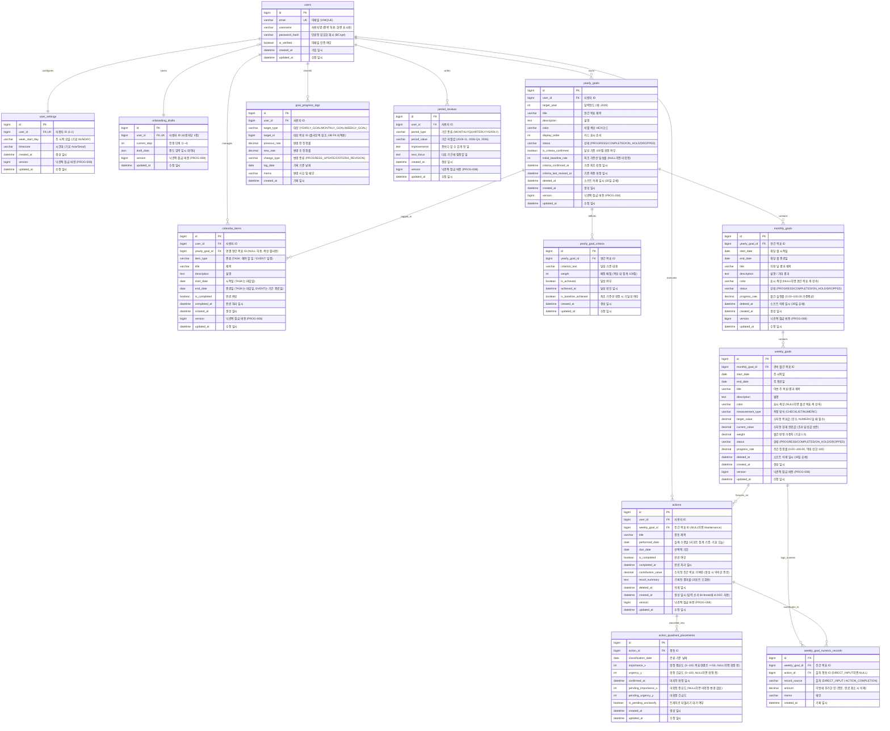

# Aim2Day 엔티티 관계 다이어그램 (ERD) 명세서

## 1. 개요 및 설계 원칙

본 문서는 Aim2Day의 [요구사항 명세서](01_requirements.md), [화면 흐름과 와이어프레임](02_user-flow-and-wireframes.md), [기능 명세서](03_functional-specification.md) 및 [프로젝트 채점 기준](../project-grading-criteria.md)을 바탕으로 작성된 관계형 데이터베이스(MySQL 8.0+) ERD 및 데이터 모델 명세서다. 일회용 인증 토큰처럼 Redis에만 보관하는 데이터는 관계형 ERD 밖에서 별도로 설명한다.

### 1.1 핵심 설계 원칙

1. **목표 3계층과 행동의 분리 및 귀속 (`GOAL-002`, `GOAL-003`, `FOCUS-001`, `FOCUS-005`)**
   - 목표 계층은 `연간 목표(Yearly Goal) → 월간 목표(Monthly Goal) → 주간 목표(Weekly Goal)`의 엄격한 3단계로 구성되며, 임의의 중간 단계(분기 목표, 6개월 목표 등)는 두지 않는다.
   - 일일 행동(`actions`)은 주간 목표에 직결되는 **핵심 집중 행동(Focus Action)**과 목표 경로가 없는 **생활 업무(Maintenance, `그 밖의 할 일`)**로 명확히 분리한다.

2. **연간 달성 기준(Criteria)과 실제 행동 기록(Execution)의 분리 (`GOAL-006`, `PLAN-002`, `REVIEW-001`, `수용기준 4`)**
   - 연간 목표의 진행률은 사용자가 정의하고 합계 100점으로 확정한 **달성 기준(Criteria)의 배점 합**으로만 산출한다.
   - 주간/월간 목표의 진행률은 하위 행동 완료율 및 실적 수치로 산출하며, 행동 완료가 연간 달성 기준을 자동으로 완료시키지 않는다.
   - 확정 시점의 달성률을 **최초 기준선(Initial Baseline)**으로 기록한다. 리포트는 해당 기간의 시작과 끝에서 관측한 달성률 차이를 표시하며, 기준선보다 앞선 성과는 추정하지 않는다.

3. **달력 일정 항목(Calendar Items)과 목표 행동(Actions)의 분리 (`DASH-006`, `DASH-010`, `FN-CAL-02`)**
   - 달력의 `해야 할 일(TASK)`과 `일정(EVENT)`은 날짜/기간 관리 데이터이며, 목표 행동의 실제 수행일(`performed_date`) 및 완료 기록과 엄격히 분리된다.
   - 달력 항목의 완료 처리는 목표 진행률이나 실제 행동 수행 이력을 생성하거나 변경하지 않는다.
   - `calendar_items`는 소프트 삭제 없이 **hard-delete** 정책을 적용한다.

4. **연간 목표 3개 한도와 소프트 삭제 30일 보존 (`GOAL-001`, `GOAL-008`, `GOAL-013`, `FN-GOAL-01~05`)**
   - 같은 달력연도, 동일 사용자에게 소프트 삭제되지 않은 연간 목표는 상태(진행/완료/보류/중단)와 무관하게 **최대 3개**까지만 허용한다.
   - 삭제는 30일 유예 기간을 두는 소프트 삭제(`deleted_at`)로 처리한다.
   - 30일 경과 후 미완료 계획만 영구 삭제하고, 완료된 과거 실적은 `deleted_at`을 유지한 채 과거 이력으로 보존한다.

5. **분산 마이크로서비스 환경 지원 (`DIST-001~007`, `NFR-004`, `NFR-008`)**
   - 인증/계정을 담당하는 `user-service`와 목표/계획/기록을 담당하는 3개의 `goal-service` 인스턴스가 동일한 MySQL 단일 데이터베이스(영속 볼륨 마운트)를 참조한다.
   - 로그인 세션과 만료되는 인증·재설정 토큰은 Redis에서 관리한다. MySQL에는 계정과 목표 등 유지할 데이터를 저장하고, 사용자별 접근 권한은 서비스에서 검증한다.

---

## 2. 전체 시스템 엔티티 관계 다이어그램 (ERD)



---

## 3. 도메인별 상세 테이블 명세 (Data Dictionary)

### 3.1 사용자 및 인증 / 설정 도메인

#### 1) `users` (사용자 계정)
- **설명**: 회원 기본 정보와 인증을 관리한다. (`AUTH-001`, `AUTH-002`, `AUTH-005`, `AUTH-006`)

| 컬럼명 | 논리명 | 데이터 타입 | Null | 기본값 | 제약/설명 |
|---|---|---|---|---|---|
| `id` | 사용자 고유 ID | BIGINT | N | AUTO_INCREMENT | PK |
| `email` | 이메일 주소 | VARCHAR(255) | N | - | UNIQUE. 로그인 및 인증 링크 수신용 |
| `username` | 사용자명 | VARCHAR(50) | N | - | 중복 허용. 화면 표시명으로만 사용하며 로그인 식별자로 사용하지 않음 |
| `password_hash` | 비밀번호 해시 | VARCHAR(255) | N | - | 단방향 해시(BCrypt). 로그 출력 엄격 금지(`NFR-010`) |
| `is_verified` | 이메일 인증 여부 | BOOLEAN | N | FALSE | 메일 인증 링크 클릭 완료 시 TRUE |
| `created_at` | 가입 일시 | DATETIME | N | CURRENT_TIMESTAMP | 계정 생성 일시 |
| `updated_at` | 수정 일시 | DATETIME | N | CURRENT_TIMESTAMP ON UPDATE | 계정 정보 변경 일시 |

- **인덱스**:
  - `idx_users_email` (UNIQUE): `email`

---

#### Redis 임시 인증 토큰 (MySQL ERD 외부)

이메일 인증과 비밀번호 재설정 토큰은 MySQL 테이블 대신 기존 세션 공유 Redis에 보관한다. 계정의 영속 상태인 `users.is_verified`와 `users.password_hash`만 MySQL에서 변경한다. (`AUTH-007`, `AUTH-008`, `FN-AUTH-02`, `FN-AUTH-04`)

| 목적 | Redis 키 | 값 | 만료 |
|---|---|---|---|
| 이메일 인증 | `auth:verify:{token_hash}` | `user_id` | 24시간 |
| 비밀번호 재설정 | `auth:reset:{token_hash}` | `user_id` | 30분 |

- 서버는 예측하기 어려운 임의 토큰을 만들고 원문은 메일 링크로만 전달한다. Redis 키에는 원문 대신 토큰의 해시를 사용하고, 원문 토큰을 DB·Redis·로그에 저장하지 않는다.
- 인증 완료 또는 새 비밀번호 제출 요청 때 전달된 토큰을 해시해 조회한다. 토큰은 만료 전에 한 번만 사용할 수 있도록 Redis 6.2+의 `GETDEL` 또는 동등한 원자적 연산으로 소비한다. 비밀번호 재설정 화면을 단순히 여는 것만으로 토큰을 소비하지 않는다.
- Redis에서 토큰을 소비한 뒤 MySQL 상태 변경이 실패하면 두 저장소를 한 트랜잭션으로 되돌릴 수 없다. 이 경우 사용자가 새 링크를 요청하도록 안내한다.
- Redis 재시작 등으로 토큰이 사라져도 계정과 비밀번호는 MySQL에 남는다. 사용자는 새 인증·재설정 링크를 요청할 수 있다. 메일 재요청 제한 등 인증 API 규칙은 [API 명세서](05_api-specification.md) §3.1을 따른다.

---

#### 2) `user_settings` (사용자 환경설정)
- **설명**: 주 시작 요일과 계정 기준 시간대를 관리한다. 오늘·주 경계·남은 일수·리포트 집계에 적용된다. (`PLAN-001`, `PLAN-004`, `FN-SET-01`, `FN-SET-02`)
- **소유 서비스**: `goal-service`. 읽기와 쓰기 모두 `goal-service`만 하며, `user-service`는 이 테이블에 접근하지 않는다. 설정 행이 없으면 `goal-service`가 기본값(SUNDAY, Asia/Seoul)으로 처음 생성한다. 이유는 결정 14 참고.

| 컬럼명 | 논리명 | 데이터 타입 | Null | 기본값 | 제약/설명 |
|---|---|---|---|---|---|
| `id` | 설정 ID | BIGINT | N | AUTO_INCREMENT | PK |
| `user_id` | 사용자 ID | BIGINT | N | - | FK → `users(id)` ON DELETE CASCADE. UNIQUE (1:1) |
| `week_start_day` | 주 시작 요일 | VARCHAR(10) | N | 'SUNDAY' | SUNDAY, MONDAY, ..., SATURDAY 중 하나 |
| `timezone` | 계정 시간대 | VARCHAR(50) | N | 'Asia/Seoul' | IANA Timezone 명칭 |
| `created_at` | 생성 일시 | DATETIME | N | CURRENT_TIMESTAMP | 생성 시각 |
| `version` | 낙관적 잠금 버전 | BIGINT | N | 0 | JPA `@Version`. 수정 요청의 값과 다르면 거부(결정 15) |
| `updated_at` | 수정 일시 | DATETIME | N | CURRENT_TIMESTAMP ON UPDATE | 변경 시각 |

- **인덱스**:
  - `idx_us_user_id` (UNIQUE): `user_id`

---

#### 3) `onboarding_drafts` (온보딩 임시 저장)
- **설명**: 첫 방문 4단계 온보딩 작성 중 이탈 시 복원을 위한 중도 입력 데이터를 보관한다. 사용자당 1행 (1:0-or-1 관계). (`PLAN-002`, 요구사항 §7 수용기준 21항)

| 컬럼명 | 논리명 | 데이터 타입 | Null | 기본값 | 제약/설명 |
|---|---|---|---|---|---|
| `id` | 임시저장 ID | BIGINT | N | AUTO_INCREMENT | PK |
| `user_id` | 사용자 ID | BIGINT | N | - | FK → `users(id)` ON DELETE CASCADE. UNIQUE |
| `current_step` | 진행 단계 | INT | N | 1 | 1~4 단계 식별 |
| `draft_data` | 입력 초안 데이터 | JSON | N | - | 각 단계별 임시 입력값 (목표명, 결과, 행동 등) |
| `version` | 낙관적 잠금 버전 | BIGINT | N | 0 | JPA `@Version`. 수정 요청의 값과 다르면 거부(결정 15) |
| `updated_at` | 수정 일시 | DATETIME | N | CURRENT_TIMESTAMP ON UPDATE | 최종 임시저장 시각 |

- **설계 결정**: 브라우저 로컬스토리지만 사용하면 다른 기기 접속·쿠키 삭제 시 유실되므로 DB에 보관한다. 온보딩 완료 후 이 행은 삭제한다.

---

### 3.2 목표 계층 및 달성 기준 도메인

#### 4) `yearly_goals` (연간 목표)
- **설명**: 달력연도(1.1~12.31) 기준 목표를 관리한다. 사용자·연도별 소프트 삭제 제외 최대 3개까지만 등록 가능하다. (`GOAL-001`, `GOAL-005`, `GOAL-006`, `GOAL-008`, `DASH-008`, `FN-GOAL-01`)

| 컬럼명 | 논리명 | 데이터 타입 | Null | 기본값 | 제약/설명 |
|---|---|---|---|---|---|
| `id` | 연간 목표 ID | BIGINT | N | AUTO_INCREMENT | PK |
| `user_id` | 소유 사용자 ID | BIGINT | N | - | FK → `users(id)` ON DELETE RESTRICT |
| `target_year` | 대상 연도 | INT | N | - | 달력연도 (예: 2026). 기간은 1.1~12.31 고정 |
| `title` | 목표 제목 | VARCHAR(100) | N | - | 표시 목표명. 과거 이력에서도 보존 |
| `description` | 목표 상세 설명 | TEXT | Y | NULL | 연간 목표의 상세 내용 |
| `color` | 목표 테마 색상 | VARCHAR(20) | N | '#3B82F6' | 달력 칩 및 목표 뱃지 식별 색상 (`GOAL-011`) |
| `display_order` | 카드 표시 순서 | INT | N | 0 | 연간 목표 메뉴 카드 정렬 순서. 사용자가 편집 가능 (`DASH-008`) |
| `status` | 상태 | VARCHAR(20) | N | 'PROGRESS' | PROGRESS(진행), COMPLETED(완료), ON_HOLD(보류), DROPPED(중단) |
| `is_criteria_confirmed` | 기준 확정 여부 | BOOLEAN | N | FALSE | 합계 100점 달성 기준 확정 시 TRUE |
| `initial_baseline_rate` | 최초 기준선 달성률 | INT | Y | NULL | 확정 시점의 달성률 (0~100%). 미확정 시 NULL |
| `criteria_confirmed_at` | 기준 최초 확정 일시 | DATETIME | Y | NULL | 달성 기준 100점 최초 확정 시각 |
| `criteria_last_revised_at` | 기준 최종 개정 일시 | DATETIME | Y | NULL | 확정 후 기준·배점을 개정할 때마다 갱신. 화면에 최근 개정 시각 표시 |
| `deleted_at` | 소프트 삭제 일시 | DATETIME | Y | NULL | 삭제 시각 기록. 30일간 복구 유예 |
| `created_at` | 생성 일시 | DATETIME | N | CURRENT_TIMESTAMP | 생성 시각 |
| `version` | 낙관적 잠금 버전 | BIGINT | N | 0 | JPA `@Version`. 수정 요청의 값과 다르면 거부(결정 15) |
| `updated_at` | 수정 일시 | DATETIME | N | CURRENT_TIMESTAMP ON UPDATE | 변경 시각 |

- **인덱스**:
  - `idx_yg_user_year_active`: `(user_id, target_year, deleted_at)`
- **한도 검사**: 생성·복원 트랜잭션에서 해당 `users` 행을 먼저 잠근 뒤 `WHERE user_id = ? AND target_year = ? AND deleted_at IS NULL` 개수가 3 미만인 경우만 허용한다.
- **리포트 비교 불가 판단**: 조회 기간 안에 기준·배점 개정 이력이 있을 때만 그 기간의 달성률 변화 비교를 생략한다. `criteria_last_revised_at`은 최근 개정 시각을 보여주는 용도로만 쓰며, 과거 기간의 개정 여부는 `goal_progress_logs`의 개정 이벤트로 판단한다.

---

#### 5) `yearly_goal_criteria` (연간 목표 달성 기준)
- **설명**: 연간 목표의 정량적/정성적 달성 기준과 배점을 관리한다. 확정 시 배점 합계는 정확히 100점이어야 한다. (`PLAN-002`, `GOAL-006`, `FN-CRIT-01`, `FN-CRIT-02`)

| 컬럼명 | 논리명 | 데이터 타입 | Null | 기본값 | 제약/설명 |
|---|---|---|---|---|---|
| `id` | 기준 고유 ID | BIGINT | N | AUTO_INCREMENT | PK |
| `yearly_goal_id` | 연간 목표 ID | BIGINT | N | - | FK → `yearly_goals(id)` ON DELETE CASCADE |
| `criterion_text` | 달성 기준 내용 | VARCHAR(255) | N | - | 사용자가 정의한 기준 설명 |
| `weight` | 배정 배점 | INT | N | - | 1~100 범위 배점. 목표 내 합계 100점은 확정 시점에 애플리케이션 레벨에서 검증 |
| `is_achieved` | 달성 여부 | BOOLEAN | N | FALSE | 사용자가 직접 달성 확인 시 TRUE |
| `achieved_at` | 달성 확인 일시 | DATETIME | Y | NULL | 달성 체크 시각 |
| `is_baseline_achieved` | 최초 기준선 반영 여부 | BOOLEAN | N | FALSE | 기준 확정 시 이미 달성된 것으로 체크했는지 여부 |
| `created_at` | 생성 일시 | DATETIME | N | CURRENT_TIMESTAMP | 등록 시각 |
| `updated_at` | 수정 일시 | DATETIME | N | CURRENT_TIMESTAMP ON UPDATE | 변경 시각 (기준·배점 개정 시 `yearly_goals.criteria_last_revised_at`도 함께 갱신) |

- **인덱스**:
  - `idx_ygc_goal_id`: `yearly_goal_id`

---

#### 6) `monthly_goals` (월간 목표)
- **설명**: 연간 목표에 연결된 달력 월 단위 목표다. 생성 당시의 현재 달을 대상으로 자동 지정된다. (`GOAL-005`, `GOAL-014`, `PLAN-003`, `FN-PLAN-02`, `PROG-004`)

| 컬럼명 | 논리명 | 데이터 타입 | Null | 기본값 | 제약/설명 |
|---|---|---|---|---|---|
| `id` | 월간 목표 ID | BIGINT | N | AUTO_INCREMENT | PK |
| `yearly_goal_id` | 부모 연간 목표 ID | BIGINT | N | - | FK → `yearly_goals(id)` ON DELETE RESTRICT |
| `start_date` | 월 시작일 | DATE | N | - | 해당 월 1일 (예: 2026-11-01). 생성 시 계정 시간대의 현재 달로 고정 (`GOAL-014`). 화면의 `2026.11` 표기는 이 값에서 만든다 |
| `end_date` | 월 종료일 | DATE | N | - | 해당 월 말일 (예: 2026-11-30) |
| `title` | 목표/결과 제목 | VARCHAR(100) | N | - | 이번 달에 이루고 싶은 결과 |
| `description` | 설명 / 기대 결과 | TEXT | Y | NULL | 상세 설명 |
| `color` | 표시 색상 | VARCHAR(20) | Y | NULL | NULL이면 부모 연간 목표의 `color`를 사용 (`GOAL-011`) |
| `status` | 상태 | VARCHAR(20) | N | 'PROGRESS' | PROGRESS, COMPLETED, ON_HOLD, DROPPED |
| `progress_rate` | 월간 실행률 (%) | DECIMAL(5,2) | N | 0.00 | 하위 주간 목표 가중 평균. 소수점 셋째 자리에서 반올림 (0.00~100.00). 직접 UPDATE로만 변경, 엔티티는 `updatable=false`(결정 16·17) |
| `deleted_at` | 소프트 삭제 일시 | DATETIME | Y | NULL | 삭제 시각 기록 (30일 유예) |
| `created_at` | 생성 일시 | DATETIME | N | CURRENT_TIMESTAMP | 생성 시각 |
| `version` | 낙관적 잠금 버전 | BIGINT | N | 0 | JPA `@Version`. 수정 요청의 값과 다르면 거부(결정 15) |
| `updated_at` | 수정 일시 | DATETIME | N | CURRENT_TIMESTAMP ON UPDATE | 변경 시각 |

- **인덱스**:
  - `idx_mg_yearly_goal`: `(yearly_goal_id, start_date, deleted_at)`

---

#### 7) `weekly_goals` (주간 목표)
- **설명**: 월간 목표에 연결된 7일 단위 주간 목표다. 체크리스트형과 수치형 측정 방식을 지원한다. 월 경계를 넘는 주는 분할하지 않고 사용자가 선택한 한 월간 목표에만 귀속한다. (`PROG-001~003`, `GOAL-006`, `PLAN-003`, `FN-PLAN-03`, `FN-PROG-01`)

| 컬럼명 | 논리명 | 데이터 타입 | Null | 기본값 | 제약/설명 |
|---|---|---|---|---|---|
| `id` | 주간 목표 ID | BIGINT | N | AUTO_INCREMENT | PK |
| `monthly_goal_id` | 귀속 월간 목표 ID | BIGINT | N | - | FK → `monthly_goals(id)` ON DELETE RESTRICT. 월 경계 주도 단일 귀속 |
| `start_date` | 주간 시작일 | DATE | N | - | 사용자 주 시작 요일 기준 시작일 |
| `end_date` | 주간 종료일 | DATE | N | - | 주간 시작일 + 6일 (7일 기간). 사용자가 나중에 주 시작 요일을 바꿔도 이미 만든 주간 목표의 기간은 바꾸지 않는다 |
| `title` | 이번 주 결과 제목 | VARCHAR(100) | N | - | 주간 목표 제목 |
| `description` | 설명 | TEXT | Y | NULL | 다음 단계 및 상세 계획 설명 |
| `color` | 표시 색상 | VARCHAR(20) | Y | NULL | NULL이면 부모 월간 목표의 색(그것도 NULL이면 연간 목표 색)을 사용 (`GOAL-011`) |
| `measurement_type` | 측정 방식 | VARCHAR(20) | N | 'CHECKLIST' | 'CHECKLIST'(행동완료비율) 또는 'NUMERIC'(수치형) |
| `target_value` | 수치형 목표값 | DECIMAL(10,2) | Y | NULL | NUMERIC일 때 필수. 양수 |
| `current_value` | 수치형 현재 완료값 | DECIMAL(10,2) | N | 0.00 | 실제 완료 합산값. 초과 달성값 원본 그대로 보존. 직접 UPDATE로만 변경, 엔티티는 `updatable=false`(결정 16·17) |
| `weight` | 월간 반영 가중치 | DECIMAL(5,2) | N | 1.00 | 월간 진행률 가중 평균 산출 가중치 |
| `status` | 상태 | VARCHAR(20) | N | 'PROGRESS' | PROGRESS, COMPLETED, ON_HOLD, DROPPED |
| `progress_rate` | 주간 진행률 (%) | DECIMAL(5,2) | N | 0.00 | 0.00~100.00. 소수점 셋째 자리에서 반올림. 수치 초과 시에도 상한 100. 직접 UPDATE로만 변경, 엔티티는 `updatable=false`(결정 16·17) |
| `deleted_at` | 소프트 삭제 일시 | DATETIME | Y | NULL | 삭제 시각 기록 (30일 유예) |
| `created_at` | 생성 일시 | DATETIME | N | CURRENT_TIMESTAMP | 생성 시각 |
| `version` | 낙관적 잠금 버전 | BIGINT | N | 0 | JPA `@Version`. 수정 요청의 값과 다르면 거부(결정 15) |
| `updated_at` | 수정 일시 | DATETIME | N | CURRENT_TIMESTAMP ON UPDATE | 변경 시각 |

- **인덱스**:
  - `idx_wg_monthly_goal`: `(monthly_goal_id, start_date, deleted_at)`

---

### 3.3 일일 행동 및 사분면 도메인

#### 8) `actions` (행동: 핵심 행동 & Maintenance)
- **설명**: 일일 수행 행동을 관리한다. 주간 목표에 연결된 핵심 행동과 연결되지 않은 생활 업무(`Maintenance`)를 모두 수용한다. (`FOCUS-001~013`, `FN-ACT-01~02`, `REVIEW-001`)

| 컬럼명 | 논리명 | 데이터 타입 | Null | 기본값 | 제약/설명 |
|---|---|---|---|---|---|
| `id` | 행동 ID | BIGINT | N | AUTO_INCREMENT | PK. **정렬 tie-break의 "기존 입력 순서"는 `id ASC`로 보장** (`FOCUS-015`) |
| `user_id` | 소유 사용자 ID | BIGINT | N | - | FK → `users(id)` ON DELETE RESTRICT |
| `weekly_goal_id` | 주간 목표 ID | BIGINT | Y | NULL | FK → `weekly_goals(id)`. NULL이면 Maintenance |
| `title` | 행동 제목 | VARCHAR(255) | N | - | 할 일 내용 |
| `performed_date` | 실제 수행일 | DATE | N | - | 리포트 집계 기준일. 기본: 작성 당일. 사용자가 수정 가능. 뒤늦은 기록도 실제 수행일 기준 집계 (`REVIEW-001`) |
| `due_date` | 마감 기한 | DATE | Y | NULL | 선택적 기한. 지정 시 남은 일수 D-Day 계산용 |
| `is_completed` | 완료 여부 | BOOLEAN | N | FALSE | 완료 체크 여부 |
| `completed_at` | 완료 처리 일시 | DATETIME | Y | NULL | 완료 체크 시각 |
| `contribution_value` | 수치형 기여 약속량 | DECIMAL(10,2) | Y | NULL | **행동 생성 시 사용자가 약속한** 수치형 주간 목표 기여 증분. 완료 시 `weekly_goal_numeric_records`에 이 값이 기록됨 |
| `result_summary` | 기록된 결과물 | TEXT | Y | NULL | 수행 후 남긴 산출물 요약. 리포트의 "기록된 결과물" 조회용 |
| `deleted_at` | 삭제 일시 | DATETIME | Y | NULL | 소프트 삭제 시각 |
| `created_at` | 생성 일시 | DATETIME | N | CURRENT_TIMESTAMP | 등록 시각 |
| `version` | 낙관적 잠금 버전 | BIGINT | N | 0 | JPA `@Version`. 수정 요청의 값과 다르면 거부(결정 15) |
| `updated_at` | 수정 일시 | DATETIME | N | CURRENT_TIMESTAMP ON UPDATE | 변경 시각 |

- **비즈니스 규칙**:
  - `weekly_goal_id IS NOT NULL` → 목표 연결 행동(Focus Action): 리포트·진행률 집계 대상
  - `weekly_goal_id IS NULL` → Maintenance(`그 밖의 할 일`): 목표 진행률·리포트에서 자동 제외
  - `contribution_value`는 생성 시 약속한 값이고, 실제 완료 가산은 `weekly_goal_numeric_records.amount`로 추적한다. 완료 취소 시 해당 `weekly_goal_numeric_records` 행을 삭제하고 `weekly_goals.current_value`를 차감한다.
  - 완료된 행동의 `contribution_value`를 바꾸면 같은 트랜잭션에서 해당 기록의 `amount`를 새 값으로 바꾸고 `current_value`에 (새 값 − 이전 값)을 더한다. 연결 주간 목표를 바꾸면 이전 목표에서 기여량을 빼고 기록을 새 목표로 옮겨 더한다.
  - 완료된 행동을 삭제하면 `deleted_at`만 기록해 목록에서 숨긴다. 완료 기록이므로 리포트 집계, 수치 기록, 체크형 진행률의 분자·분모에 그대로 남는다. 미완료 행동을 삭제하면 체크형 진행률의 분모에서 빠진다.
- **인덱스**:
  - `idx_act_user_perf_date`: `(user_id, performed_date, deleted_at)`
  - `idx_act_weekly_goal`: `(weekly_goal_id, is_completed)`

---

#### 9) `action_quadrant_placements` (일일 사분면 중요도/긴급도 좌표)
- **설명**: 오늘 할 일에 대해 사용자가 드래그/키보드로 사분면에 배치한 좌표를 저장한다. **확정 좌표**와 **미확정 좌표**를 따로 둔다. 점을 옮기면 미확정 좌표만 바뀌고, `[오늘 분류 확정]`을 눌러야 확정 좌표가 바뀐다. 이미 확정한 점을 다시 옮기고 확정하지 않으면 이전 확정 좌표가 그대로 남는다. (`FOCUS-014~016`, `FN-QUAD-01~02`)

| 컬럼명 | 논리명 | 데이터 타입 | Null | 기본값 | 제약/설명 |
|---|---|---|---|---|---|
| `id` | 분류 배치 ID | BIGINT | N | AUTO_INCREMENT | PK |
| `action_id` | 대상 행동 ID | BIGINT | N | - | FK → `actions(id)` ON DELETE CASCADE |
| `classification_date` | 분류 기준 날짜 | DATE | N | - | 해당 좌표가 적용된 날짜. 계정 시간대 기준 |
| `importance_x` | 확정 중요도 | INT | Y | NULL | 0~100. 목표 연결 행동은 반드시 ≥ 50 (`FOCUS-016`). 한 번도 확정하지 않았으면 NULL |
| `urgency_y` | 확정 긴급도 | INT | Y | NULL | 0~100. `importance_x`와 함께 NULL이거나 함께 값이 있다 |
| `confirmed_at` | 마지막 확정 일시 | DATETIME | Y | NULL | 확정 좌표가 바뀔 때마다 현재 시각으로 갱신 |
| `pending_importance_x` | 미확정 중요도 | INT | Y | NULL | 0~100. 목표 연결 행동은 ≥ 50. 확정하지 않은 변경이 없으면 NULL |
| `pending_urgency_y` | 미확정 긴급도 | INT | Y | NULL | 0~100. `pending_importance_x`와 함께 NULL이거나 함께 값이 있다 |
| `is_pending_unclassify` | 트레이로 되돌리기 대기 | BOOLEAN | N | FALSE | 확정된 점을 트레이로 옮긴 뒤 아직 확정하지 않은 상태. TRUE이면 미확정 좌표는 NULL |
| `created_at` | 생성 일시 | DATETIME | N | CURRENT_TIMESTAMP | 사분면 배치 시각 |
| `updated_at` | 수정 일시 | DATETIME | N | CURRENT_TIMESTAMP ON UPDATE | 당일 재분류·확정 시 변경 시각 |

- **인덱스**:
  - `idx_aqp_action_date` (UNIQUE): `(action_id, classification_date)`
- **상태 흐름**:

| 상태 | 확정 좌표 | 미확정 좌표 | `is_pending_unclassify` | 화면 |
|---|---|---|---|---|
| 미분류 | 행 없음 | 행 없음 | - | 트레이의 점 |
| 미확정 | NULL | 있음 | FALSE | 미확정 위치의 점 |
| 확정 | 있음 | NULL | FALSE | 확정 위치의 점 |
| 재분류 중 | 있음 | 있음 | FALSE | 미확정 위치의 점. 확정 전까지 확정 좌표 유지 |
| 되돌리기 대기 | 있음 | NULL | TRUE | 트레이의 점. 확정 전까지 확정 좌표 유지 |

- **확정 처리**: 미확정 좌표가 있으면 확정 좌표로 옮기고 미확정 좌표를 NULL로 만든다. `is_pending_unclassify=TRUE`인 행은 지운다(미분류).
- **변경 취소**: 미확정 좌표와 `is_pending_unclassify`만 초기화한다. 확정 좌표가 없던 행이면 행을 지운다.
- **날짜가 지난 미확정 값**: 분류는 오늘만 할 수 있어 `classification_date`가 오늘이 아닌 행의 미확정 좌표와 `is_pending_unclassify`는 확정·취소할 수 없다. 이 값들은 읽을 때 없는 것으로 취급하고(확정 좌표만 사용) 지우지 않는다. 별도 정리 작업은 두지 않는다. (`FN-QUAD-02`, API 결정 18)

---

### 3.4 달력 및 대시보드 도메인

#### 10) `calendar_items` (달력 일정 항목: 해야 할 일 & 일정)
- **설명**: 달력과 대시보드에서 조회되는 항목이다. 마감일 기반의 `해야 할 일(TASK)`과 하루/기간 기반의 `일정(EVENT)`으로 구분된다. 대시보드의 `해야 할 일`·`일정` 두 열도 이 테이블에서 가져온다. 삭제는 소프트 삭제 원칙의 예외로 즉시 hard-delete한다(휴지통·복원 없음). (`DASH-001`, `DASH-006`, `DASH-010`, `FN-CAL-01~02`)

| 컬럼명 | 논리명 | 데이터 타입 | Null | 기본값 | 제약/설명 |
|---|---|---|---|---|---|
| `id` | 달력 항목 ID | BIGINT | N | AUTO_INCREMENT | PK |
| `user_id` | 소유 사용자 ID | BIGINT | N | - | FK → `users(id)` ON DELETE CASCADE |
| `yearly_goal_id` | 연결 연간 목표 ID | BIGINT | Y | NULL | FK → `yearly_goals(id)` ON DELETE SET NULL. 색상·목표별 필터용. 연간 목표 단위로만 연결 (`DASH-007`) |
| `item_type` | 항목 종류 | VARCHAR(10) | N | - | 'TASK'(해야 할 일) 또는 'EVENT'(일정) |
| `title` | 항목 제목 | VARCHAR(255) | N | - | 일정/할 일 이름 |
| `description` | 상세 내용 | TEXT | Y | NULL | 메모 및 상세 설명 |
| `start_date` | 시작일 | DATE | N | - | TASK: 마감일 / EVENT: 시작일 |
| `end_date` | 종료일 | DATE | N | - | TASK: 마감일 / EVENT: 종료일(하루 일정은 start_date와 동일) |
| `is_completed` | 완료 여부 | BOOLEAN | N | FALSE | 완료 체크 여부. 완료 항목은 달력에서 옅게 표시 |
| `completed_at` | 완료 처리 일시 | DATETIME | Y | NULL | 완료 체크 시각 |
| `created_at` | 생성 일시 | DATETIME | N | CURRENT_TIMESTAMP | 등록 시각 |
| `version` | 낙관적 잠금 버전 | BIGINT | N | 0 | JPA `@Version`. 수정 요청의 값과 다르면 거부(결정 15) |
| `updated_at` | 수정 일시 | DATETIME | N | CURRENT_TIMESTAMP ON UPDATE | 변경 시각 |

- **주의**: 달력 항목 완료는 목표 행동의 실제 수행일(`performed_date`)이나 목표 진행률을 생성·변경하지 않는다.
- **인덱스**:
  - `idx_ci_user_type_dates`: `(user_id, item_type, start_date, end_date, is_completed)`
  - `idx_ci_goal_filter`: `(yearly_goal_id)`

---

### 3.5 진행률 및 실적 추적 도메인

#### 11) `goal_progress_logs` (목표 진행률 변경 이력)
- **설명**: 연간·월간·주간 목표의 진행률 관측값과 연간 달성 기준 개정 이벤트를 날짜와 함께 기록한다. `target_id`는 `target_type`에 따라 연간/월간/주간 목표 PK를 가리키는 **폴리모픽 참조**이며 DB FK를 적용하지 않는다. (`PROG-007`, `DASH-005`, `FN-DASH-02`)

| 컬럼명 | 논리명 | 데이터 타입 | Null | 기본값 | 제약/설명 |
|---|---|---|---|---|---|
| `id` | 이력 ID | BIGINT | N | AUTO_INCREMENT | PK |
| `user_id` | 사용자 ID | BIGINT | N | - | FK → `users(id)` ON DELETE CASCADE |
| `target_type` | 대상 목표 단계 | VARCHAR(20) | N | - | 'YEARLY_GOAL', 'MONTHLY_GOAL', 'WEEKLY_GOAL' |
| `target_id` | 대상 목표 ID | BIGINT | N | - | **폴리모픽 참조. DB FK 미적용.** target_type에 따라 yearly_goals/monthly_goals/weekly_goals PK를 가리킴. 부모 목표가 소프트 삭제·아카이빙되어도 이력 행은 보존 |
| `previous_rate` | 변경 전 진행률 | DECIMAL(5,2) | N | - | 0.00~100.00 (%) |
| `new_rate` | 변경 후 진행률 | DECIMAL(5,2) | N | - | 0.00~100.00 (%) |
| `change_type` | 변경 종류 | VARCHAR(30) | N | 'PROGRESS_UPDATE' | 'PROGRESS_UPDATE' 또는 'CRITERIA_REVISION'. 기준·배점 개정은 개정 전후 달성률이 같아도 기록 |
| `log_date` | 기록 기준 날짜 | DATE | N | - | 계정 시간대 기준 날짜 |
| `memo` | 변경 메모 / 사유 | VARCHAR(255) | Y | NULL | 예: "행동 완료에 따른 주간 목표 갱신" |
| `created_at` | 기록 일시 | DATETIME | N | CURRENT_TIMESTAMP | 기록 시각 |

- **인덱스**:
  - `idx_gpl_user_recent`: `(user_id, created_at DESC)`
  - `idx_gpl_target_date`: `(target_type, target_id, log_date, created_at)`

---

#### 12) `weekly_goal_numeric_records` (수치형 주간 목표 실적/기여 기록)
- **설명**: 수치형 주간 목표에 대해 직접 입력(`DIRECT_INPUT`)된 실적 증분 또는 행동 완료(`ACTION_COMPLETION`)로 반영된 기여량을 추적한다. (`PROG-003`, `FN-PROG-01`)

| 컬럼명 | 논리명 | 데이터 타입 | Null | 기본값 | 제약/설명 |
|---|---|---|---|---|---|
| `id` | 수치 기록 ID | BIGINT | N | AUTO_INCREMENT | PK |
| `weekly_goal_id` | 주간 목표 ID | BIGINT | N | - | FK → `weekly_goals(id)` ON DELETE CASCADE |
| `action_id` | 출처 행동 ID | BIGINT | Y | NULL | FK → `actions(id)` ON DELETE SET NULL. DIRECT_INPUT이면 NULL. ACTION_COMPLETION이면 NOT NULL |
| `record_source` | 실적 출처 | VARCHAR(20) | N | - | 'DIRECT_INPUT' 또는 'ACTION_COMPLETION' |
| `amount` | 추가한 양 (증분) | DECIMAL(10,2) | N | - | 누적이 아닌 "이번에 추가한 양". 완료 취소 시 이 행을 삭제하고 `weekly_goals.current_value` 차감 |
| `memo` | 메모 | VARCHAR(255) | Y | NULL | 직접 입력 시 사용자 메모 |
| `created_at` | 기록 일시 | DATETIME | N | CURRENT_TIMESTAMP | 기록 시각 |

- **중복 방지 전략**:
  - `action_id`에 UNIQUE 제약을 둔다. 같은 행동 완료 요청이 여러 인스턴스에 동시에 도착해도 행동 기여 기록은 한 행만 삽입할 수 있다. 서로 다른 행동의 동시 완료까지 막지는 못하므로 `current_value`는 `UPDATE weekly_goals SET current_value = current_value + :delta WHERE id = :id`로 DB에서 원자적으로 바꾼다(결정 16). 기록 삽입·삭제와 `current_value` 변경, 진행률 재계산은 같은 MySQL 트랜잭션에서 처리한다.
  - `DIRECT_INPUT`의 `action_id`는 NULL이다. MySQL UNIQUE 인덱스는 여러 NULL을 허용하므로 같은 주간 목표에 직접 기록을 여러 번 추가할 수 있다.
  - 완료 취소 시 행동 기여 기록을 삭제하고 기여량을 차감하는 작업도 같은 트랜잭션에서 처리한다.
- **인덱스**:
  - `uk_wgnr_action_id` (UNIQUE): `action_id`
  - `idx_wgnr_goal_source`: `(weekly_goal_id, record_source, action_id)`

---

### 3.6 회고 및 리포트 도메인

#### 13) `period_reviews` (기간별 사용자 직접 작성 회고)
- **설명**: 월말, 달력 분기말, 연말에 사용자가 직접 작성하는 회고 내용을 보관한다. (`REVIEW-002`, `FN-REPORT-03`)

| 컬럼명 | 논리명 | 데이터 타입 | Null | 기본값 | 제약/설명 |
|---|---|---|---|---|---|
| `id` | 회고 ID | BIGINT | N | AUTO_INCREMENT | PK |
| `user_id` | 작성 사용자 ID | BIGINT | N | - | FK → `users(id)` ON DELETE CASCADE |
| `period_type` | 기간 유형 | VARCHAR(10) | N | - | 'MONTHLY', 'QUARTERLY'(달력 분기), 'YEARLY' |
| `period_value` | 기간 식별값 | VARCHAR(20) | N | - | 'YYYY-MM'(예: 2026-11), 'YYYY-Q4'(예: 2026-Q4), 'YYYY'(예: 2026) |
| `improvements` | 전보다 할 수 있게 된 일 | TEXT | Y | NULL | 사용자가 직접 작성한 성과/역량 회고 |
| `next_focus` | 다음 기간에 집중할 일 | TEXT | Y | NULL | 사용자가 직접 작성한 다음 기간 집중 계획 |
| `created_at` | 작성 일시 | DATETIME | N | CURRENT_TIMESTAMP | 최초 작성 시각 |
| `version` | 낙관적 잠금 버전 | BIGINT | N | 0 | JPA `@Version`. 수정 요청의 값과 다르면 거부(결정 15) |
| `updated_at` | 수정 일시 | DATETIME | N | CURRENT_TIMESTAMP ON UPDATE | 수정 시각 |

- **인덱스**:
  - `idx_pr_user_period` (UNIQUE): `(user_id, period_type, period_value)`

---

## 4. 비즈니스 규칙 및 데이터 무결성 보장 상세

### 4.1 연간 목표 최대 3개 제약 보장 (`GOAL-001`, `FN-GOAL-01`)

- 동일 사용자(`user_id`), 동일 달력연도(`target_year`)에 대해 소프트 삭제되지 않은(`deleted_at IS NULL`) 연간 목표는 목표 상태(PROGRESS, COMPLETED, ON_HOLD, DROPPED)와 상관없이 **최대 3개**다.
- 모든 목표 생성·복원 API는 MySQL 트랜잭션을 시작하고 첫 조회로 `SELECT id FROM users WHERE id = ? FOR UPDATE`를 실행해 해당 사용자 행을 잠근다. 이어서 해당 연도의 활성 연간 목표 개수를 확인하고 3개 미만일 때만 생성·복원한 뒤 커밋한다. 모든 인스턴스가 같은 잠금 순서를 따라야 동시 요청에도 한도를 지킬 수 있다.
- 3개 초과 시 `GOAL_LIMIT_EXCEEDED` 오류 코드를 반환하며 생성·복원을 차단하고, 현재 개수·최대 개수와 가능한 조치를 안내한다.

---

### 4.2 연간 목표 달성 기준(100점) 및 최초 기준선(Baseline) 관리 (`GOAL-006`, `PLAN-002`, `REVIEW-001`)

- 온보딩 중 달성 기준 확정 미요구. 미확정(`is_criteria_confirmed=FALSE`) 시 연간 진행률 퍼센트 미노출 → `달성 기준 설정하기` 반환.
- 확정 시 `yearly_goal_criteria.weight` 합계가 정확히 100점이어야 한다.
- **기준 확정 트랜잭션**:
  1. 배점 합계 100 검증
  2. 사용자가 선택한 기달성 기준의 배점 합 → `initial_baseline_rate` 저장
  3. `criteria_confirmed_at`, `criteria_last_revised_at` 현재 시각으로 저장
  4. `is_criteria_confirmed = TRUE`
- 기준 확정 시 최초 달성률을 `goal_progress_logs`에도 시작 관측값으로 기록한다. 이후 달성 기준의 완료·취소와 기준 개정 때마다 변경 전후 달성률을 기록한다. 기록이 없는 날짜의 진행률은 그 날짜 직전의 마지막 관측값을 사용한다.
- **기준·배점 개정 시**: `yearly_goal_criteria` 행 추가/수정/삭제 + `yearly_goals.criteria_last_revised_at` 갱신. 배점 합계 100점 재검증. 같은 트랜잭션에서 `goal_progress_logs`에 `change_type='CRITERIA_REVISION'` 행을 남긴다. 개정 전후 달성률이 같아도 기록한다.
- **리포트 집계 시**: 각 기간 시작과 끝에서 관측 가능한 연간 달성률 차이를 %p로 표시한다. 최초 확정이 기간 중이라면 최초 기준선을 시작값으로 쓰고 실제 관측 시작일을 밝힌다. 최초 기준선 이전의 성과는 계산하지 않는다. 해당 기간에 `CRITERIA_REVISION` 이벤트가 있으면 그 기간의 변화량은 "기준·배점 변경으로 비교 불가"로 표시한다. 이후 기간은 새 기준에서 다시 비교할 수 있다. 과거 기간에 개정 이벤트가 없었다면 나중에 기준을 바꾸더라도 과거 리포트를 비교 불가로 바꾸지 않는다.

---

### 4.3 주간 목표(체크형/수치형) 및 월간 목표 진행률 산출 (`PROG-001~006`)

**체크리스트형 주간 목표**:
$$\text{주간 진행률} = \text{ROUND}\left( \frac{\text{완료 연결 행동 수}}{\text{전체 연결 행동 수}} \times 100,\ 2 \right)$$
연결 행동이 0개 → '기록 없음' 반환 (퍼센트 미표시)

**수치형 주간 목표**:
- `current_value`의 모든 변경(완료·완료 취소·기여량 수정·완료한 행동의 주간 목표 이동·직접 입력 추가·삭제)은 Java에서 읽어 더하지 않고 `UPDATE weekly_goals SET current_value = current_value + :delta WHERE id = :id`로 DB에서 처리한다. 이어서 같은 트랜잭션에서 `SELECT ... FOR UPDATE`로 주간 목표 → 월간 목표(연간 목표에는 저장하는 진행률이 없다) 순서로 잠그고, 값을 다시 읽어 `progress_rate`를 계산한다(결정 16)
- 행동 완료 시: `actions.contribution_value` → `weekly_goal_numeric_records` (source=ACTION_COMPLETION) 삽입 + `weekly_goals.current_value` 증가
- 직접 입력 시: 사용자 입력 증분 → `weekly_goal_numeric_records` (source=DIRECT_INPUT) 삽입 + `weekly_goals.current_value` 증가
- 완료 취소 시: 해당 `weekly_goal_numeric_records` 행 삭제 + `weekly_goals.current_value` 차감
- `progress_rate` = MIN(100, ROUND(current_value / target_value × 100, 2))
- 완료 색상은 반올림한 진행률이 아니라 `current_value >= target_value`로 판단한다. (예: 9999.99/10000은 100.00으로 반올림되지만 아직 미완료)
- `current_value`는 초과 달성값을 원본 그대로 보존 (예: 14/10 → progress_rate=100, current_value=14.00)

**월간 목표 실행률**:
$$\text{월간 진행률} = \text{ROUND}\left( \frac{\sum_{i}(\text{주간 진행률}_i \times \text{가중치}_i)}{\sum_{i} \text{가중치}_i},\ 2 \right)$$
- 모든 진행률은 소수점 셋째 자리에서 반올림(HALF_UP)해 둘째 자리까지 저장·표시한다. Java에서는 `BigDecimal.setScale(2, RoundingMode.HALF_UP)`를 사용한다. 월간 계산에는 이미 반올림된 주간 진행률을 사용한다.
- 기록 없는 하위 주간 목표(0%)도 분모에 포함
- 하위 주간 목표가 0개일 때만 '기록 없음'

---

### 4.4 소프트 삭제(30일 복구 유예) 및 과거 이력 보존 (`GOAL-008`, `GOAL-013`, `FN-GOAL-05`)

**삭제 즉시**: `deleted_at = NOW()` 기록. 하위 목표·미완료 행동을 일반 조회·대시보드에서 숨김.

**30일 경과 후 영구 정리 배치**:

목표를 남길지는 `status` 값이 아니라 **완료 기록이 하나라도 연결되어 있는지**로 판단한다. 완료 기록은 다음 세 가지다.
- 완료한 행동: `actions.is_completed = TRUE`
- 달성한 기준: `yearly_goal_criteria.is_achieved = TRUE` (연간 목표에만 해당)
- 수치형 실적 기록: `weekly_goal_numeric_records` 행

처리 순서:
1. 대상 경로의 `actions` 중 `is_completed=FALSE` → hard-delete (`action_quadrant_placements`는 CASCADE로 함께 삭제)
2. `weekly_goals` 중 남은 완료 행동도, 수치형 실적 기록도 없는 것 → hard-delete. 하나라도 있으면 보존
3. `monthly_goals` 중 남은 하위 주간 목표가 없는 것 → hard-delete. 있으면 보존
4. `yearly_goals` 중 남은 하위 월간 목표도, 달성한 기준도 없는 것 → hard-delete (기준 행은 CASCADE). 하나라도 있으면 보존
5. 보존된 행은 `deleted_at`을 유지한 채 과거 이력으로 남고, 복원·부모 선택 대상에서 제외한다.
6. `goal_progress_logs`의 target_id는 소프트 삭제된 목표를 가리켜도 이력 행 보존 (폴리모픽 참조이므로 DB FK 미강제).

> **FK ON DELETE RESTRICT 설계 유지**: 배치에서 하위 → 상위 순서로 처리하면 RESTRICT와 충돌하지 않는다. 완료 이력이 남은 경우 부모 행을 hard-delete 하지 않으므로 RESTRICT가 보호 역할을 올바르게 수행한다.

**리포트에서 보존된 과거 이력**: 소프트 삭제된 목표·행동도 `is_completed=TRUE`이면 집계 쿼리에 포함한다. 단, 현재 계획이나 새 행동의 부모로는 선택할 수 없다.

---

### 4.5 일일 사분면 중요도/긴급도 제약 (`FOCUS-014~016`, `FN-QUAD-01~02`)

- **목표 연결 행동** (`weekly_goal_id IS NOT NULL`): 중요도 `x ≥ 50`만 허용, 긴급도 `y`는 0~100 자유.
- **Maintenance** (`weekly_goal_id IS NULL`): `x`, `y` 모두 0~100 자유.
- **미분류(트레이)**: 레코드 없음.
- **미확정(pending)**: 사용자가 사분면에 점을 놓거나 옮기면 `pending_importance_x`, `pending_urgency_y`만 바꾼다. 확정 좌표는 건드리지 않는다.
- **확정**: `[오늘 분류 확정]` 클릭 시 한 트랜잭션에서 그날의 모든 미확정 좌표를 확정 좌표로 옮기고 `confirmed_at=NOW()`로 갱신한다. 되돌리기 대기 행은 지운다.
- 이미 확정한 점을 다시 옮기거나 트레이로 되돌려도 확정을 누르기 전까지 이전 확정 좌표를 유지한다(`FN-QUAD-02`).
- 트레이에 남은 점은 미분류 상태를 유지 (레코드 없음).
- 오늘이 아닌 `classification_date`의 행은 확정 좌표만 읽는다. 미확정 좌표·`is_pending_unclassify`는 무시한다(`FN-QUAD-02`).
- 사분면 좌표는 순수 표시/정렬용이며 목표 진행률·행동 순서를 변경하지 않는다.

---

## 5. 분산 서비스 및 데이터베이스 인프라 구조

### 5.1 Docker 컨테이너 구성 및 DB 영속성 (`DIST-001~007`, `NFR-008`)

```text
[ 브라우저 / 프론트엔드 (Pure HTML/CSS/JavaScript) ]
                     │
                     ▼ (호스트 포트)
        [ Nginx (역방향 프록시 컨테이너) ]
           │                                │
   /api/auth                       /api/goals, /api/actions
   /api/users                      /api/calendar, /api/reports
                                   /api/settings
           │                                │ Round-Robin 분산
           ▼                                ▼
  [ user-service (1대) ]    [ goal-service-1 | goal-service-2 | goal-service-3 ]
           │         │               │               │               │
           │         └───────────────┴───────────────┘               │
           ▼                         ▼                               ▼
     [ Redis (세션·임시 토큰) ] [ MySQL 8.0 DB 컨테이너 (단일) ]
                                             │
                                             ▼
                               [ Docker Named Volume (/var/lib/mysql) ]
```

1. **단일 DB 영속 볼륨**: `user-service`와 3대의 `goal-service` 인스턴스는 동일한 MySQL 컨테이너에 접속. MySQL 컨테이너 재기동·재생성 후 동일 볼륨 연결 시 데이터 영구 보존.
2. **세션 공유와 단기 토큰**: Spring Session + Redis. 역방향 프록시가 Round-Robin으로 `goal-service` 인스턴스 중 어디로 보내도 로그인 세션을 유지한다. 이메일 인증·비밀번호 재설정 토큰은 목적별 Redis 키와 TTL로 관리한다.
3. **인스턴스 식별자** (`DIST-003`): 모든 `goal-service` 응답에 `X-Instance-Id` 헤더(컨테이너 호스트명/IP) 포함하여 분산 처리 입증.
4. **소유권 검증**: `goal-service`에서 `weekly_goals`, `monthly_goals` 접근 시 `yearly_goals.user_id` 까지의 조인으로 소유권 확인. 단순 과제 범위에서는 정규화 유지.

---

## 6. 문서 간 정합성 검토 및 결정 사항

### 결정 1 — 사분면 좌표 테이블 분리 (`FOCUS-016`)
행동 테이블에 직접 좌표를 두면 날짜별 독립성이 훼손된다. `action_quadrant_placements`로 분리해 `(action_id, classification_date)` UNIQUE 키를 적용. 확정 좌표와 미확정 좌표를 별도 컬럼에 두어, 확정한 점을 다시 옮겨도 다시 확정하기 전까지 이전 확정 좌표가 남는다(`FN-QUAD-02`). 상태는 미분류(레코드 없음)·미확정·확정·재분류 중·되돌리기 대기로 구분한다(§3.3의 9번 테이블).

### 결정 2 — 달력 항목의 목표 연결 단위 (`DASH-007`, `DASH-010`)
달력 필터·색상은 연간 목표 단위이므로 `calendar_items.yearly_goal_id` (NULLABLE)로 연결. 월간/주간 목표에 종속시키지 않고 독립 엔티티 유지.

### 결정 3 — 온보딩 임시 저장 DB 보관 (요구사항 §7 수용기준 21항)
기능 명세서에서 미결로 남긴 "중도 작성 보존 정책"을 `onboarding_drafts` 테이블로 해결. 로컬스토리지 의존 시 다른 기기·쿠키 삭제에 취약하므로 DB 보관 선택. 온보딩 완료 후 행 삭제.

### 결정 4 — 수치형 초과 달성값 처리 (`PROG-003`)
`weekly_goals.current_value`에 실제 달성 수치 원본 보존. `progress_rate`는 100 상한을 적용한 DECIMAL(5,2) 값으로 저장.

### 결정 5 — 30일 하드 딜리트 패턴 (`GOAL-008`, `GOAL-013`)
FK ON DELETE RESTRICT를 유지하되 배치 처리는 하위(actions) → 중간(weekly_goals, monthly_goals) → 상위(yearly_goals) 순서로 진행한다. 목표는 완료 기록(완료 행동·달성 기준·수치 기록)이 하나도 없을 때만 hard-delete하고, 하나라도 있으면 `deleted_at IS NOT NULL`로 아카이빙한다. 목표의 `status`는 이 판단에 쓰지 않는다. 보존된 과거 이력은 리포트 집계에는 포함하되 현재 목표 선택 목록에 노출하지 않음.

### 결정 6 — `criteria_last_revised_at` 추가 (`GOAL-006`, `REVIEW-001`)
`criteria_last_revised_at`은 최근 개정 시각을 표시한다. 기간별 비교 불가 여부는 `goal_progress_logs.change_type='CRITERIA_REVISION'` 이벤트로 판단한다. `criteria_confirmed_at`은 최초 확정 시각만 가리킨다.

### 결정 7 — 이메일 전용 로그인과 사용자명 중복 허용 (`AUTH-002`)
로그인 식별자는 UNIQUE 제약이 있는 `email`만 사용한다. `username`은 화면 표시명이며 다른 사용자와 같아도 된다.

### 결정 8 — `calendar_items` hard-delete 정책
달력 항목은 삭제 복원·아카이빙 요구사항이 없으므로 소프트 삭제 없이 hard-delete 적용. 과제 범위 단순화. 기능 명세서 §1의 "삭제는 소프트 삭제" 원칙에 대한 명시적 예외다.

### 결정 9 — AI·BYOK 관련 테이블 미포함
제출판 AI·BYOK·결제 기능은 "개발 중" 안내만 표시. 미확정 보안 설계가 필요한 BYOK 키 테이블 등은 본 ERD에서 제외. 확장 시 별도 설계.

### 결정 10 — 일회용 인증 토큰은 Redis에 보관
이메일 인증·비밀번호 재설정 토큰은 수명이 짧고 한 번만 사용하므로 MySQL 테이블을 두지 않는다. Redis 키에 원문 토큰의 해시를 사용하고 TTL을 설정한다. 인증 완료와 비밀번호 변경 결과는 MySQL의 `users` 행에 영속적으로 기록한다.

### 결정 11 — 월간·주간 목표 표시 색상 (`GOAL-011`, `FN-GOAL-02`)
월간·주간 목표에도 `color`를 둔다. 값이 NULL이면 부모 목표의 색을 그대로 쓰므로, 사용자가 따로 바꾸지 않으면 한 목표 경로가 같은 색으로 보인다. 달력 항목은 결정 2대로 연간 목표 색을 사용한다.

### 결정 12 — `monthly_goals.year_month` 제거
`YEAR_MONTH`는 MySQL 예약어이고, 대상 월은 `start_date`로 알 수 있어 중복 컬럼이다. 월 조회·인덱스는 `start_date`를 사용하고 `end_date`는 주간 목표와 기간 겹침 검사를 단순하게 하려고 유지한다.

### 결정 13 — 진행률은 소수점 둘째 자리까지 저장
주간·월간 진행률과 진행률 이력은 DECIMAL(5,2)로 저장하고 소수점 셋째 자리에서 반올림한다. 연간 달성률은 정수 배점의 합이므로 `initial_baseline_rate`는 INT를 유지한다.

### 결정 14 — `user_settings`는 `goal-service`가 소유 (`PLAN-001`, `PLAN-004`)
주 시작 요일과 시간대는 사용자 정보이지만, 이를 사용하는 곳은 오늘·주 경계·남은 일수·리포트 기간을 계산하는 `goal-service`뿐이다. 따라서 설정 테이블과 설정 API(`/api/settings`)를 `goal-service`가 소유하고 `user-service`는 접근하지 않는다. 설정 화면은 기본 정보(사용자명·이메일)를 `user-service`에서, 주 시작 요일·시간대를 `goal-service`에서 각각 조회한다.

`user-service`가 테이블을 소유하고 `goal-service`가 읽기만 하는 방식도 검토했으나, 한 테이블을 두 서비스가 공유하면 다음 문제가 생기므로 채택하지 않았다.
- 컬럼 변경이 다른 서비스를 깨뜨린다. `user-service` 쪽에서 `week_start_day` 이름이나 형식을 바꾸면 `goal-service`가 바로 오류를 낸다. 테이블 주인은 하나인데 고칠 때는 두 서비스가 맞춰야 한다.
- 따로 배포하기 어려워진다. 서비스를 나누는 목적은 각자 따로 바꾸고 배포하는 것인데, 테이블을 공유하면 그 장점이 줄어든다.
- DB를 나눌 수 없다. 나중에 서비스마다 DB를 분리하려 할 때 바로 막힌다.

제출판은 모든 서비스가 MySQL 하나를 사용하고 목표 테이블이 `users(id)`를 외래키로 참조하므로 DB 수준의 결합은 남아 있다. 다만 테이블별 쓰기 주체는 하나의 서비스로 정해 서비스 경계를 지킨다.

### 결정 15 — 수정 가능한 테이블에 `version` 컬럼 추가 (`PROG-008`)
`user_settings`, `onboarding_drafts`, `yearly_goals`, `monthly_goals`, `weekly_goals`, `actions`, `calendar_items`, `period_reviews`에 `version BIGINT NOT NULL DEFAULT 0`을 둔다. JPA `@Version`으로 처리한다. 같은 목표를 두 브라우저 탭에서 고치거나, RR로 나뉜 요청이 서로 다른 인스턴스에서 동시에 처리될 때 오래된 요청이 최신 값을 덮어쓰지 않게 한다. 수정 요청의 `version`이 저장된 값과 다르면 API는 409 `VERSION_CONFLICT`를 반환한다([API 명세서](05_api-specification.md) §2.4).

- 달성 기준 목록은 부모 `yearly_goals.version`으로 함께 보호한다.
- 하위 행동 완료로 주간·월간 `progress_rate`만 다시 계산할 때는 `version`을 올리지 않는다. 사용자가 고치는 필드와 서버가 계산하는 필드를 구분해, 행동 완료가 열려 있는 목표 수정 화면과 충돌하지 않게 한다. Hibernate는 기본적으로 엔티티를 저장(flush)할 때 어느 필드든 바뀌면 `@Version`을 올리므로, 이 규칙은 엔티티 저장으로는 지킬 수 없고 결정 17의 방식으로 지킨다.
- `action_quadrant_placements`, `weekly_goal_numeric_records`, `goal_progress_logs`, `yearly_goal_criteria`에는 두지 않는다. 앞의 둘은 UNIQUE 제약과 트랜잭션으로, 진행 기록은 추가만 하므로 충돌하지 않는다.

### 결정 16 — 진행률은 원자적 UPDATE와 고정 잠금 순서로 갱신 (`PROG-003`, `PROG-004`, `DIST-002`)
**문제.** `weekly_goal_numeric_records.action_id` UNIQUE는 같은 행동이 두 번 가산되는 것만 막는다. 서로 다른 행동 A(기여 2)와 B(기여 1)를 두 인스턴스에서 동시에 완료하고 두 행동이 같은 주간 목표를 가리키면, 각 인스턴스가 `current_value`를 3으로 읽어 한쪽은 5, 다른 쪽은 4를 써서 최종값이 5나 4가 된다(맞는 값은 6). 기여량 하나가 사라지고, 오류도 나지 않아 알 수 없다. 월간 진행률도 같다. 같은 달의 주간 목표 W1, W2가 동시에 바뀌면 각 요청이 상대 변경이 반영되기 전의 값으로 평균을 내고 마지막에 쓴 쪽이 이긴다.

**결정.**
- `weekly_goals.current_value`의 모든 변경(완료, 완료 취소, 기여량 수정, 완료한 행동의 주간 목표 변경, `DIRECT_INPUT` 추가·삭제)은 `UPDATE weekly_goals SET current_value = current_value + :delta WHERE id = :id`로 DB에서 원자적으로 처리한다. Java에서 읽어 더한 값을 저장하지 않는다. DB가 행 잠금을 잡고 현재 저장값에 더하므로 5나 4 대신 6이 된다.
- `progress_rate`(주간, 이어서 월간)는 같은 트랜잭션에서 `SELECT ... FOR UPDATE`로 행을 잠근 뒤 값을 다시 읽어 계산한다. 잠금 전에 읽은 값은 쓰지 않는다. 잠금 순서는 주간 목표 → 월간 목표로 고정한다. 현재 저장하는 연간 진행률은 없으므로 연간 목표 행은 잠그지 않으며, 나중에 생기면 월간 다음에 잠근다. 순서를 고정하지 않으면 요청 X는 주간→월간, 요청 Y는 월간→주간으로 잠가 서로 기다리는 교착 상태가 생긴다.
- 수치 기록 삽입·삭제는 같은 트랜잭션에서 처리한다. 중간에 실패하면 기록과 `current_value`가 함께 롤백된다.

**버린 대안.** (1) `@Version` 낙관적 잠금을 진행률에도 적용하고 충돌 시 재시도: 같은 목표에서 행동이 동시에 완료될 때마다 `OptimisticLockException`이 나 재시도 코드가 필요하고, 열려 있는 목표 수정 화면이 행동 완료마다 409가 된다(결정 17). (2) `SERIALIZABLE` 격리 수준: 모든 쓰기에 적용되어 불필요하게 느리고 교착이 늘어난다. (3) 잠금 없이 `current_value`만 원자적 UPDATE하고 진행률은 그냥 계산: 두 요청이 각자 잠금 없이 읽은 값으로 비율을 계산해 마지막에 쓴 쪽이 이기므로, `current_value`는 맞아도 `progress_rate`가 한 단계 전 값으로 남을 수 있다.

### 결정 17 — 진행률 컬럼은 엔티티에서 읽기 전용으로 두고 `version`을 올리지 않는다 (`PROG-008`)
**문제.** 결정 15는 "진행률만 바뀔 때 `version`을 올리지 않는다"고 했지만, Hibernate는 기본적으로 관리 중인 엔티티의 어느 필드든 바뀌어 flush되면 `@Version`을 올린다. 일반적인 엔티티 저장으로는 이 규칙을 지킬 수 없다. 더 큰 문제는 값 덮어쓰기다. 사용자가 목표 제목을 고치는 요청이 주간 목표를 읽었을 때 `current_value`는 3이었다. 그 사이 다른 인스턴스에서 행동 완료가 DB를 5로 바꿨다. 수정 요청이 flush되면서 모든 컬럼을 쓰면 `current_value`가 3으로 되돌아가 완료한 기여량이 사라진다. 진행률 변경은 `version`을 올리지 않으므로 낙관적 잠금도 이를 잡지 못한다.

**결정.**
- `current_value`, `progress_rate`(주간·월간)처럼 서버가 계산하는 컬럼은 결정 16의 직접 JPQL/SQL UPDATE로만 바꾼다. 벌크·직접 UPDATE는 `version`을 건드리지 않는다(`versioned` 키워드를 쓰지 않는다). 연간 목표에는 저장하는 진행률이 없고, 기준 달성은 기준 테이블 변경이며 `yearly_goals.version`으로 보호한다(결정 15).
- 엔티티에서는 이 컬럼들을 `@Column(updatable = false)`로 매핑해 엔티티 관점에서 읽기 전용으로 둔다. 제목 수정 같은 저장이 오래된 `current_value`나 `progress_rate`를 다시 쓰지 않는다. 위 예에서 DB의 5가 유지된다.
- 사용자 수정이 `target_value`, `weight`, `monthly_goal_id`처럼 진행률에 영향을 주는 값을 바꾸면, 엔티티 저장 뒤에 결정 16과 같은 잠금·직접 UPDATE 경로로 진행률을 다시 계산한다.

**버린 대안.** 진행률이 바뀔 때도 `version`을 올리는 방법: 같은 목표에서 행동이 동시에 완료되면 `OptimisticLockException`이 나 재시도가 필요하고, 사용자가 목표 수정 화면을 열어 둔 동안 행동을 하나 완료할 때마다 저장이 409 `VERSION_CONFLICT`가 된다. 사용자가 고치지 않은 값 때문에 충돌하는 것은 의도와 맞지 않는다.
